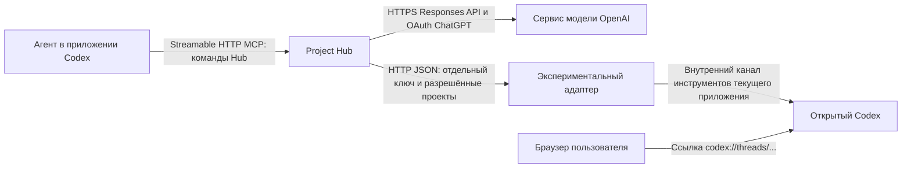

# Архитектура подключений приложений и план доработок настроек

Это разбор реализации для разработки интерфейса, начатый 19 октября и обновлённый 20 октября 2026 года. Он объясняет настройки подключённого приложения на примере Codex и отделяет их от собственных запросов Hub к модели. Описание проблем фиксирует состояние до доработки; этапы 1–3 реализованы в исходниках. Этап 4 реализован экспериментальным адаптером и принят на работающем Desktop: Hub создал чат в выбранном проекте, отправил сообщение, получил ответ и подтверждение присутствия чата в каталоге приложения. Этап 5 связывает этот адаптер с типизированными запусками задач; этап 6 остаётся планом.

В реализации первых трёх этапов добавлена серверная проекция `controlStatus` и `features`, разделяющая заявления, настройки и проверенные факты. Вкладки доступа, чатов, привязок и диагностики имеют отдельные назначения. История проверок сохранена; сохранение адреса и обновление профиля больше не запускают сетевую проверку. Оформление использует самостоятельные секции с рамками и акцентами в стиле общих настроек.

Исходная проблема — интерфейс объединял разные источники данных и разные степени подтверждения. Инструмент, доступный агенту в чате, показывался рядом с возможностью сервера Hub управлять приложением, хотя готового маршрута между ними могло не быть. Формулировка «Не проверено» скрывала отсутствие такого маршрута.

## Направления связи

### Агент обращается к Hub

Hub выступает MCP-сервером, Codex — MCP-клиентом. Агент получает каталог инструментов Hub и вызывает команды работы с задачами, этапами, отчётами, документами и привязками проектов. Авторизация использует отдельный токен Hub.

Успешный запрос с действующим токеном подтверждает этот входящий путь в момент запроса. Он не доказывает, что агент сейчас выполняет задачу, что новый чат прочитает правила или что Hub умеет создать чат Codex.

### Hub обращается к сервису модели

Это собственный исполнитель исследований Hub. Он получает учётные данные из настроек провайдера и посылает HTTPS-запросы к API модели. При входе через ChatGPT используется OAuth и протокол Responses API. Приложение Codex для такого запроса не требуется.

Результат сохраняется в Hub. Текущий действующий исполнитель поддерживает анализ архитектуры и подготовку, обновление и проверку документации. Он сообщает `nativeChat=false`, `sourceExecution=false`, `taskExecution=false`. Доступ модели к разрешённым инструментам исследования предоставляет внутренний посредник Hub; это не запуск агента в приложении Codex.

### Hub управляет чатами приложения

Для этого нужен отдельный доступный серверу интерфейс приложения или адаптера. В общем механизме Hub реализованы два транспорта: `mcp-http` и `http-json`. Здесь MCP-роли меняются: Hub становится клиентом внешнего сервера управления.

Профиль приложения описывает операции, а администратор отдельно сохраняет адрес и учётные данные. Заявленный адрес и протокол должны совпасть с сохранёнными. Знание имени инструмента внутри агентского чата не создаёт внешний интерфейс управления.

### Пользователь открывает ссылку на чат

Ссылка `codex://threads/...` адресует существующий чат через обработчик ссылок на компьютере пользователя. Хранение такой ссылки, чтение каталога чатов, создание чата через API и фактическое открытие окна — отдельные возможности. Наличие корректного адреса не подтверждает открытие приложения.

## Исходное состояние подключения Codex до этапа 4

При первоначальном разборе проверены ответы работающего Hub через нативный MCP и читающие HTTP-запросы. Сервер работал из исходников этого репозитория; отдаваемый `connections.js` совпадал с рабочим файлом после нормализации переводов строк. Следующий снимок описывает состояние до подключения адаптера, а не текущую конфигурацию.

- Доступ агента к инструментам Hub работает: Hub получил авторизованные MCP-вызовы в ходе разбора.
- В профиле заявлены `createChat` через `mcp__codex_app__create_thread` и `sendMessage` через `mcp__codex_app__send_message_to_thread`.
- В профиле нет `control`; сохранённого адреса управления также нет: `control=null`.
- Две сохранённые попытки проверки имеют `configuration_required`. Они завершились до создания тестового чата.
- Правила отмечены клиентом как сохранённые и соответствующие текущему комплекту. `loadVerified=false` и `compactionVerified=false`: это самостоятельные неподтверждённые проверки.
- В настройках запросов Hub выбран провайдер ChatGPT: Responses API, OAuth, модель `gpt-6.1-sol`; сохранённая проверка доступности успешна. Это результат предыдущей проверки, а не гарантия следующего запроса.
- Действующий API возможностей исследований сообщает `transport=api`, `nativeChat=false`, `sourceExecution=false`, `taskExecution=false`.

Для такого состояния корректная формулировка: **«Управление из Hub не подключено: доступный интерфейс приложения не указан»**. Названия агентских инструментов сами по себе не подтверждают доступность этих операций серверу Hub. После этапа 4 профиль описывает операции HTTP-адаптера, а результат живой проверки приведён ниже.

## Откуда берутся данные

### Приглашение и первоначальная настройка

Приглашение — начальный HTTP-обмен, после которого настраивается MCP. Браузер открывает `/connect/...`; bootstrap возвращает адрес регистрации, адрес MCP и комплект инструкций. Регистрация через `/api/v1/agent/enroll` выдаёт токен подключения. Затем клиент сохраняет нативную конфигурацию Streamable HTTP MCP и проверяет каталог инструментов.

Поэтому фраза «первое подключение происходит по MCP через приглашение» требует уточнения: приглашение помогает получить и установить MCP-подключение; сама выдача подключения выполняется HTTP-регистрацией. Приглашение не является адресом MCP и не даёт Hub управление клиентом.

Источники: `scripts/agent_api.py:24`, `scripts/native_onboarding.py:146`, `scripts/native_mcp_setup.py:204`.

### Подключение, профиль и сохранённый интерфейс управления

`agent_connections` хранит подключение, хеш токена, сведения клиента, отзыв доступа и время наблюдавшегося запроса. `connection_profiles` содержит JSON, полученный через `hub_connection(action="describe")`. `connection_controls` хранит отдельно подтверждённый администратором адрес, протокол и ссылку на секрет. `connection_probes` хранит попытки проверок и их результаты.

`Connections.catalog()` объединяет подключения с `Profiles.public()` и отдаёт `/api/connections`. Интерфейс `connections.js` выводит полученную проекцию. Отчёт клиента, административная настройка и результат проверки здесь имеют разное происхождение; это должно быть видно пользователю.

Источники: `scripts/agent_bindings.py:44`, `scripts/agent_bindings.py:314`, `scripts/connection_capabilities.py:254`, `scripts/connection_capabilities.py:306`, `scripts/project_portal.py:1696`.

### Настройки запросов к модели

`agent_provider_settings` хранит выбранный сервис и конфигурацию модели. Секреты находятся в отдельном приватном хранилище. OAuth ChatGPT обслуживает `ChatGPTAuth`; `Providers.credential()` получает токен; `ApiAgentRuns` запускает `provider_runtime.Driver`, который отправляет запрос API.

Эти настройки действуют для установки Hub. Подключения приложений также глобальны в современной схеме. Параметр выбранного проекта в URL не делает эти настройки свойствами только этого проекта. Проектные привязки приложения — отдельные записи.

Источники: `scripts/agent_providers.py:53`, `scripts/agent_providers.py:77`, `scripts/agent_providers.py:108`, `scripts/chatgpt_auth.py:115`, `scripts/api_agent_runs.py:353`, `scripts/provider_runtime.py:297`, `tools/project-portal/web/agent-providers.js:8`.

## Значение карточек и строк исходного интерфейса

Этот раздел объясняет замечания к интерфейсу до этапов 1–3. Текущие вкладки и состояния описаны в целевой структуре и результатах реализации.

### Подключение инструментов Hub

Сейчас это справочный текст во вкладке доступа. В карточке нет действия подключения, адреса MCP, результата нативного обнаружения или кнопки проверки. Она объясняет назначение уже выданного доступа, хотя заголовок и оформление похожи на действие настройки.

Нужно заменить её конкретным блоком «Агент → Hub»: доступ выдан или отозван, способ подключения, последний успешный запрос, доступные действия настройки и восстановления. Показ адреса не должен раскрывать токен.

### Запросы Hub к модели

Это справочная ссылка на отдельные настройки запросов к моделям. Карточка не описывает возможность подключённого Codex и не отражает выбранный провайдер или его проверку. Во вкладке доступа достаточно короткой ссылки с объяснением области действия. Самостоятельная настройка должна оставаться в «Запросах к моделям».

Обе карточки формируются прямо в `tools/project-portal/web/connections.js:182`; их оформление задаётся в `connections.css:39`.

### Возможности и профиль

Заголовок «Возможности, заявленные приложением» относится ко всему разделу. Вложенный «Профиль, сообщённый клиентом» выводит среду и версию. Следующие строки создания чата и отправки сообщения — заявления из `profile.capabilities`. Ниже «Результаты проверок» выводит другую структуру, `row.capabilities`.

Проблема структуры подтверждается HTML: внешние заголовки и заголовок вложенного профиля имеют одинаковый уровень `h4`, а CSS задаёт им одинаковый размер. Заявления и результаты повторяют названия операций в двух списках, вместо одной строки с источником и состоянием.

Источники: `connections.js:111`, `connections.js:128`, `connections.css:78`.

### Почему диагностика повторяет управление

Обе вкладки вызывают `renderCapabilities()`. В управлении параметр `outgoingOnly` исключает только MCP из списка результатов; в диагностике показан весь список. Данные одни и те же. Это повторное представление, а не отдельная диагностика.

В диагностике нужны детали попыток: направление, операция, время, версия настройки, этап остановки и техническая причина. Рабочее состояние каждой функции должно иметь одно основное место во вкладке управления.

Источники: `connections.js:184`, `connections.js:187`.

### Что реально подтверждают проверки

- **Инструменты Hub через MCP.** `Profiles.public()` выставляет `verified` по `last_seen` авторизованного запроса. Это свидетельство входящего доступа, без проверки полного каталога и будущей загрузки правил. Тот же слой команд доступен через HTTP API, поэтому источник наблюдения стоит записывать явно, а не выводить транспорт только из общего `last_seen`.
- **Создание чата.** Сконфигурированный API вернул пригодный идентификатор чата. Это не подтверждение окна приложения или выполнения агентом поручения.
- **Отправка сообщения.** Настроенная операция завершилась без ошибки для возвращённого идентификатора. Это принятие команды API, а не завершение ответа модели.
- **Ответ из тестового чата.** Получен callback с совпавшими одноразовым nonce и ожидаемым `nativeId` до срока проверки. Это корреляция проверочного обмена, не независимая аттестация процесса или окна.
- **Открытие чата.** Формируется или проверяется ссылка; `guiVerified=false` сохраняется и после успешного тестового обмена. Автоматического доказательства открытия окна здесь нет.

Источники: `connection_capabilities.py:306`, `connection_capabilities.py:442`, `connection_capabilities.py:516`, `native_chats.py:19`, `native_chats.py:84`.

## Исходные проблемы модели состояния

1. `Profiles.public()` заранее создаёт строки всех пяти возможностей со значением `unknown`, даже без профиля или маршрута управления. Общий текст «Не проверено» не отличает отсутствующую реализацию, ненастроенный интерфейс и готовую к проверке функцию.
2. Счётчик «Завершено 2 из 2» считает терминальные попытки, включая `configuration_required`, ошибки и тайм-ауты. Он не является счётчиком успешных проверок.
3. `canProbeControl()` сравнивает только адрес и протокол. Настоящий запуск дополнительно требует корректную операцию, аргументы, `projectRouting`, `$requestId` и контекст проекта. Успешная общая проба сама по себе не подтверждает запуск работы в нужном проекте.
4. `Profiles.configure(..., base=...)` после сохранения автоматически вызывает `test()`. Обновление профиля при наличии настройки тоже способно запустить пробу. Проба создаёт чат и может вызвать модель; это отдельное действие, которое должно быть явно названо пользователю.
5. «Доступ к 4 проектам» вычисляется как число активных `projectBindings`. Это число привязок, а не проверенная граница прав. Для глобального подключения `Connections.projects()` возвращает зарегистрированные проекты установки, а `select_project()` выбирает явный проект. Корректное название счётчика — «Привязано проектов: 4»; область доступа следует описывать отдельно.
6. Идентичность последнего чата в профиле подключения и идентичность конкретной текущей сессии имеют разные сроки жизни. Нельзя делать один профиль подключения источником сведений обо всех чатах.

Источники: `connection_capabilities.py:306`, `connection_capabilities.py:292`, `connection_capabilities.py:344`, `connections.js:117`, `connections.js:134`, `connections.js:166`, `agent_launches.py:82`, `agent_bindings.py:270`, `agent_runtime.py:341`.

## Что можно настроить и проверить сейчас

### Доступ Codex к инструментам Hub

Для нового подключения: создать приглашение в «Приложениях», выполнить штатную регистрацию и установку нативного Streamable HTTP MCP, сохранить комплект правил, получить каталог инструментов в Codex и выполнить читающий `hub_context` с действительной привязкой проекта. Загрузку правил новым чатом проверять отдельным новым чатом; повторная регистрация существующего рабочего подключения для этого не требуется.

Для текущего подключения этот путь работает. Оставшиеся проверки загрузки инструкций относятся к поведению клиента, а не к API модели или управлению чатами.

### Запросы самого Hub

Открыть «Запросы к моделям», войти через ChatGPT либо добавить сервис с API-ключом, выбрать модель и конфигурацию для запросов Hub, выполнить явную проверку запроса. Успех подтверждает выбранный сервис и модель в момент проверки. Он не требует проверки создания чата Codex. Текущее подключение ChatGPT уже имеет успешную сохранённую проверку.

### Открытие существующего чата

Нужны действительные идентификатор и источник чата. Затем пользователь открывает ссылку и подтверждает результат. Ошибки отсутствующего обработчика или недоступного чата относятся к открытию ссылки. Чтение локального каталога Codex помогает получить метаданные, но не предоставляет создание, отправку или подтверждение активности.

### Создание чата и отправка из Hub

Для установки из исходников реализован экспериментальный адаптер текущего Codex. Порядок настройки, выбор разрешённых папок, проверка и восстановление описаны в [инструкции подключения](codex-desktop-control.md). Настройка запускается из действительного чата Codex; затем пользователь отдельно выбирает привязку проекта и запускает проверку в Hub.

Если такой адаптер предоставлен, он должен объявить документированный интерфейс и операции. В Hub сохраняются его точные адрес и протокол: `mcp-http` для сервера MCP с `tools/list` и `tools/call`; `http-json` для HTTP JSON-операций, описанных путями и аргументами. Учётные данные этого доступа отделены от токена агента к Hub и от OAuth модели. Проверка идёт последовательно: соединение, обнаружение операции, создание тестового чата, отправка, коррелированный ответ; открытие окна проверяется отдельно.

Исходный профиль с названиями `mcp__codex_app__...` не содержал такого endpoint и полноценного описания аргументов маршрутизации. Скрипт настройки адаптера сохраняет согласованные профиль, адрес и отдельный ключ одной административной операцией с проверкой ревизии. Сохранение не создаёт чат. Адрес самого Hub `/mcp` и сервис Responses обслуживают другие направления связи.

Официальный Codex App Server предоставляет собственный JSON-RPC с `thread/start`, `thread/resume`, `turn/start`; это не HTTP MCP и не произвольный HTTP JSON endpoint. Для интеграции с ним нужен отдельный адаптер. Документированные транспорты включают stdio и WebSocket; WebSocket обозначен экспериментальным. Этот API сам по себе не доказывает присоединение чата к уже открытому Desktop-приложению. См. [официальную документацию Codex App Server](https://learn.chatgpt.com/docs/app-server).

Старые экспериментальные `hub_chat_actions.py` и `codex_adapter.py` не используются новым адаптером. Действующий `UnifiedActions` обслуживает API-исследования и чтение старых результатов; это отдельный путь. Настоящий адаптер реализован в `codex_desktop_bridge.mjs`, подключается через `codex_desktop_setup.py` и обслуживает стандартную проверку возможностей подключения. Типизированный запуск задачи через этот маршрут реализован в этапе 5; API-исследования остаются отдельным исполнителем.

Источники: `unified_actions.py:10`, `unified_actions.py:50`, `project_portal.py:1437`, `project_portal.py:2250`, `hub_launcher.py:450`, `codex_session_catalog.py:57`.

## Целевая структура настроек

На уровне установки остаются три подраздела: «Приложения», «Запросы к моделям», «Правила работы». В шапке явно указывается область действия: настройки этой установки Hub.

В приложении нужны следующие вкладки:

- **Доступ к Hub.** Направление «Агент → Hub», токен и его отзыв, адрес MCP без секрета, наблюдавшийся успешный запрос, настройка и восстановление подключения. Краткий результат установки правил со ссылкой на их настройки.
- **Чаты приложения.** Отдельные возможности открытия ссылки, создания, отправки и получения подтверждения. Одна строка на функцию: доступность в интеграции, настройка, результат и время проверки, следующее действие. Если адаптера нет, явно назвать это состояние и не предлагать бессодержательную проверку.
- **Привязки проектов.** Связи областей клиента с проектами Hub, состояние проектного правила, ремонт и отключение привязки. Счётчик привязок не называть ограничением доступа.
- **Диагностика.** Журнал попыток и технические сведения с источником и временем, версиями настроек, транспортными ошибками и границами подтверждения. Без второго полного списка возможностей.

Подробный профиль клиента раскрывается в диагностике. Общее объяснение прямых запросов к модели заменяется короткой ссылкой на самостоятельный раздел.

Состояние функции следует хранить по независимым признакам: поддержка выбранным адаптером, наличие настройки, последний проверенный факт и время/версия проверки. Из них интерфейс получает понятные состояния: «Интерфейс не предоставлен», «Не поддерживается этой интеграцией», «Нужно настроить», «Готово к проверке», «Проверяется», «Подтверждено: конкретный факт», «Ошибка», «Ответ не получен», «Настройка изменилась». Заявление клиента остаётся отдельным источником сведений.

## Порядок доработок

### Этап 1 Уточнить контракт состояний

Определить направления, область действия и источники каждого поля. Ввести серверную проекцию состояния, учитывающую возможности реально установленного адаптера, декларацию клиента, сохранённую настройку и актуальные результаты. Сохранить историю старых профилей и проверок.

Приёмка: подключение без `control` не выглядит готовым к тестированию; отсутствие декларации не превращается в ложное «не поддерживается»; привязки проектов отделены от прав; изменение конфигурации делает прежний результат неактуальным.

Основные файлы: `connection_capabilities.py`, `agent_bindings.py`, `agent_launches.py`. Проверки: `test_connection_onboarding.py`, соответствующие контракты из `test_agent_http.py` и `test_agent_contracts.py`.

### Этап 2 Исправить интерфейс по действующим возможностям

Перестроить вкладки по описанной структуре, убрать повторный блок из диагностики, выровнять уровни заголовков, объединить состояние одной функции в одном месте. Вынести профиль в технические сведения. Счётчик попыток заменить явным перечислением исходов. При отсутствии адаптера показывать отсутствие подключённого интерфейса управления.

Приёмка: с каждого экрана понятно, кто кому обращается, что настроено, что подтверждено и какое действие доступно. Настройки запросов к модели не выглядят свойством Codex или выбранного проекта.

Основные файлы: `connections.js`, `connections.css`, `settings.js`, каталог локализации. Проверки: `test_connections_ui.py`, `test_settings_ui.py`, визуальная проверка актуальных вкладок и узкого окна.

### Этап 3 Разделить сохранение и проверки

Убрать автоматическое создание чата из сохранения адреса и описания профиля. Разделить проверку транспорта, создание чата, принятие сообщения и коррелированный ответ. Предупреждение о создании тестового чата показывать до явного запуска этой операции. Для функции только открытия ссылки не требовать создания чата.

Приёмка: сохранение не создаёт чатов и не вызывает модель; повтор запроса не дублирует побочный эффект; история показывает точную стадию остановки, а callback не выдаётся за доказательство открытия окна.

Основные файлы: `connection_capabilities.py`, `agent_api.py`, `connections.js`. Проверки: профильные HTTP/контрактные тесты на временном endpoint, тайм-ауты, смену настроек и повтор операции.

### Этап 4 Реализовать выбранный маршрут управления Codex

Требуемый результат — управление чатами действующего Desktop-приложения. Выбран адаптер к внутреннему каналу текущего экземпляра, который Codex передаёт своему агенту. Этот канал не является публичным стабильным API; подключение явно обозначено экспериментальным. Документированный App Server и отдельный агентский исполнитель остаются самостоятельными вариантами интеграции.

Инструменты, доступные агенту в Desktop-чате, можно использовать из самого чата в пределах пользовательского запроса. Чтобы сервер Hub вызывал их самостоятельно, требуется предоставленный приложением интерфейс или явно реализованный мост. Общий HTTP/MCP профиль без такого моста недостаточен. Решение об адаптере принимается до добавления новых форм адресов и протоколов.

Приёмка: один явный запрос из Hub создаёт чат в требуемом проекте и целевом экземпляре приложения; Hub получает действительный ID, подтверждение получения задания, затем результат. Отдельно проверяется видимость чата в Desktop. Тесты подставного HTTP endpoint не заменяют эту приёмку.

#### Причина отсутствия сокета и выбранный маршрут

Первоначальная проверка 19 октября закончилась ошибкой сокета. Дополнительное исследование и живая приёмка 20 октября установили рабочий маршрут. Факты относятся к проверенной установке, а не ко всем версиям Codex:

- Текущий Desktop запускает дочерний `app-server` без `--listen`, с транспортом `stdio`. У него нет daemon control socket. Команда `app-server daemon version` обращалась к другому, отсутствующему интерфейсу. Её `os error 10050` не доказывает отказ сетевого стека Windows: отдельная проверка Unix-сокета через .NET успешно передала данные.
- [Документация App Server](https://learn.chatgpt.com/docs/app-server) описывает JSON-RPC, запуск сервера и подключение клиента. Она не устанавливает маршрут обнаружения текущего Desktop или гарантию появления созданного таким сервером чата в его проекте. Поэтому запуск нового App Server не выполнялся как подмена управления текущим приложением.
- [Документированные ссылки](https://learn.chatgpt.com/docs/reference/commands#chats) позволяют открыть `codex://threads/new` с `path` и `prompt`. Параметр `prompt` заполняет редактор сообщения, но не отправляет его. Этот путь пригоден для ручного начала чата, но не выполняет автоматическую отправку из Hub.
- Codex передаёт агентскому процессу `CODEX_APP_TOOLS_PIPE_PATH` и `CODEX_THREAD_ID`. Адаптер использует только этот унаследованный канал и действительного вызывающего; он не ищет приватные каналы других процессов. Через штатный протокол инструментов приложения подтверждены `list_projects`, `list_threads`, `read_thread`, `create_thread` и `send_message_to_thread`.

#### Реализация и приёмка этапа 4

Hub обращается по HTTP JSON к локальному адаптеру с отдельным ключом. Адаптер разрешает только создание, отправку и проверку; произвольного ретранслятора инструментов нет. Папка привязки Hub должна точно соответствовать разрешённой папке и проекту из свежего каталога Codex. Нативный ID проекта сохраняется отдельно от канонического ID Hub. Перед отправкой принадлежность чата проверяется повторно; отправлять можно только в чаты, созданные этим экземпляром адаптера.

Запись операции сохраняется до побочного эффекта. Повтор с тем же ID возвращает результат; неизвестный исход не вызывает повторного создания. Каталог приложения может обновляться с задержкой: адаптер до 18 секунд повторяет только чтение, а профиль задаёт 30 секунд на создание. При закрытии нативного канала HTTP-сервер останавливается. После закрытия или обновления Codex требуется повторное подключение из нового чата.

Живая проверка запущена кнопкой Hub, а не прямым вызовом агентом `create_thread`. Результат — `passed`: создан чат в выбранном локальном проекте текущего приложения, API принял сообщение, затем из того же чата пришёл callback с совпавшим одноразовым кодом и ID. Присутствие и проект дополнительно подтверждены чтением `codex_app.list_threads`; завершённый ответ прочитан через `read_thread`. Доказательства и журналы проверок прикреплены к этапу в Hub. Промежуточные диагностические чаты архивированы с сохранением истории.

Присутствие в каталоге не подтверждает переключение окна: `guiOpened=false` сохранён явно. База и конфигурация Codex не менялись; автоматизация интерфейса Codex и запуск отдельного App Server не использовались. Контрактные проверки покрывают маршрутизацию, разные ID проектов Hub/Codex, задержку каталога, повторные запросы, неизвестный исход, ограничения доступа, HTTP-границы и атомарное сохранение настройки. Пройдены соответствующие проверки backend, адаптера, интерфейса и синтаксиса JavaScript; полный релизный набор не запускался.

### Этап 5 Свести маршрут запуска с общей моделью приложений

Связать адаптер с существующими `Launches` и типизированным заданием: проект, привязка и её ревизия, requestId, направление результата. Проверять возможности маршрутизации тем же правилом, которое использует настоящий запуск. Сохранить границу внутренних исследований и обычных задач; не подменять один тип другим.

Приёмка: повторная отправка не создаёт второй чат; неверная или изменившаяся привязка отклоняется; продолжение попадает только в подтверждённый чат; принятие API, подтверждение агента и завершение работы отражаются раздельно.

#### Реализация этапа 5

В карточке задачи и выбранного этапа добавлен самостоятельный блок запуска. Он получает доступные маршруты только для текущего проекта, предлагает создание нового чата или продолжение подтверждённого чата этой же задачи и этапа. Интерфейс хранит выбор и инструкцию при обновлениях; сохранённые результаты API-исследований по-прежнему отображаются отдельно.

Используется существующий `Launches`: административный запрос `launch` сохраняет запись до обращения к адаптеру. Конверт содержит существующую задачу, этап, канонический проект Hub, привязку, её ревизию и фактическую область проекта. Снимок задания содержит объём, приёмку, источники и выбранные этапы; история отчётов и активность в него не копируются. Перед первым ACK повторно проверяется содержание задания. Подтверждение вычисляет снимок до SQL-транзакции записи, чтобы обновление читающей модели не блокировало SQLite.

API возвращает идентификатор и подтверждение каталога приложения. Агент отдельно вызывает `hub_launch(ack)` со своим действительным ID и областью проекта. Завершение ссылается только на принадлежащий этому агенту отчёт по указанной задаче/этапу, созданный после ACK. Текст и источники отчёта сохраняются в результате запуска. Принятие команды, подтверждение получения и завершение имеют отдельные отметки времени.

Продолжение требует завершённый или завершившийся ошибкой, ранее подтверждённый запуск в той же задаче, этапе и неизменившемся маршруте. Незавершённый или неопределённый исход блокирует отправку в этот чат. Адаптер дополнительно проверяет собственный журнал владения и фактический проект Codex. Повтор того же requestId возвращает запись; потерянный ответ не запускает создание повторно. В UI повтор отправляет исходное тело запроса и блокирует новое изменение до выяснения результата.

Контрактные проверки покрывают полный цикл start → ACK → новая работа → отчёт → complete → продолжение, изменение входных данных, чужую задачу/этап, ревизию настройки, видимость и HTTP-доступность новых ресурсов. DOM-проверки вызывают настоящие обработчики формы: создание, продолжение, точный повтор, устаревший GET, смена маршрута, ссылки и источники результата. Полный релизный набор не запускался.

Живая приёмка этапа 5 выполнена через форму Hub: создание чата в выбранном проекте завершилось ACK и новым отчётом. Затем через режим продолжения отправлено второе поручение; оно пришло в тот же нативный чат, создало отдельную работу после нового ACK и вернуло отдельный результат. Оба запуска имеют `completed`, одинаковый nativeId, разные requestId и resultRef. Новые задачи и дополнительные чаты для продолжения не создавались; исходники и статусы этапов принимающий агент не менял. Результаты и подтверждения каталога приложения сохранены в истории запусков, доказательства прикреплены к этапу.

### Этап 6 Проверить сценарии и обновить справку

Автоматизированная приёмка выполняется на временных каталогах и локальных HTTP/pipe-стендах. Покрыты MCP без управления чатами, ссылка без интерфейса создания, сохранение без проверки, отозванный доступ, несовпадение адреса, устаревание доказательств, тайм-аут обратного ответа, задержка каталога, потеря нативного ответа и изоляция двух проектов. Живые создание, продолжение, каталог и ACK текущего Codex подтверждены на этапах 4–5; они не подменяются результатами стенда.

Исправлена область доказательств проверок: незавершённая проверка проекта A больше не блокирует проект B. API сохраняет привязку каждой попытки, проверяет её перед приёмом обратного ответа и отменяет позднее подтверждение изменённой привязки. Публикуемые `projectVerifications` разделяют результаты по привязкам; UI показывает доказательства выбранного проекта и проект каждой попытки в диагностике. Старое доказательство не становится общим подтверждением приложения.

Уточнена обработка запуска: исчезновение задачи или этапа до ACK сохраняет отменённое состояние. Реальное изменение выбранного этапа проверяется через `hub_plan` и отклоняет старое задание. Известный отказ до отправки не удерживает форму в режиме точного повтора; текст отказа сохраняется при обновлении состояния. Сохранённый `dispatch_unknown` блокирует новое задание формы этого этапа, продолжая ждать поздний ACK. Повтор запроса Hub возвращает только его квитанцию. Универсальное восстановление неизвестного внешнего исхода не реализовано и не заявляется.

Отдельный тест проходит через настоящий HTTP-маршрут провайдеров Hub, сохранённое подключение ChatGPT, получение тестового OAuth-токена и локальный сокет сервиса с Responses SSE. В тесте нет переменных окружения Codex; создание процессов, нативные запуски и управление чатами запрещены assertions. Проверяются успешный ответ, сохранённая квитанция, точный повтор без нового запроса, неизвестный исход тайм-аута без повтора и полный цикл исследования с публикацией результата в знаниях Hub. OAuth и сервис модели в этом стенде подменены тестовыми данными; это проверка независимого пути сервера, а не производственной авторизации или фактического выхода из Desktop.

Физическое закрытие текущего Codex не выполняется из управляющего им чата: оно прервёт проверяющую сессию. Для отдельной ручной приёмки подготовлены действия в `mcp-project-connections.md`: обычный браузер, работающий Hub, выход из Codex, новая проверка модели и исследование с публикацией. Этот пункт нельзя считать пройденным по успешному стендовому тесту или по старой квитанции.

Живая явная проверка сохранённого подключения ChatGPT вернула `chatgpt_identity_invalid`
до обращения к модели, без записей модельного транспорта. Проверка идентичности при
подготовке авторизации отклонила ответ; точная криптографическая причина по этой
квитанции неизвестна. Сохранённые токены не читаются и проверка не ослабляется.
Требуется повторный вход пользователя через «Изменить» у подключения. Для такого
отказа добавлено отдельное пояснение в интерфейсе, даже когда сетевых диагностик
нет. После восстановления входа нужно повторить живую проверку с закрытым Codex.

Обновлены справка о MCP-подключениях, инструкция адаптера, объяснение прямого анализа и граница прежнего stdio-исполнителя. Встроенные пояснения отдельно обозначают направление запросов к модели и область проектных проверок.

Порядок зависимостей: этапы 1–5 реализованы. Для этапа 6 остаётся отдельная ручная приёмка после фактического выхода из Codex. Совместимость экспериментального канала после обновлений Codex требует повторной проверки.

## Границы исходного разбора и последующей реализации

Первоначальный разбор был читающим и изменял только этот документ. Затем по отдельным запросам реализованы этапы 1–5, добавлены адаптер и инструкция, сохранено подключение и выполнен реальный обмен с Codex. Этап 6 добавляет проверки отказов, изоляции и прямого модельного пути; физический выход из Desktop остаётся отдельным неподтверждённым сценарием.

## Основные исходники для проверки

- [Интерфейс подключений](../tools/project-portal/web/connections.js) и [его оформление](../tools/project-portal/web/connections.css).
- [Профили, настройки управления и проверки](../scripts/connection_capabilities.py).
- [Регистрация и область доступа подключений](../scripts/agent_bindings.py).
- [Маршрутизация запусков в приложение](../scripts/agent_launches.py).
- [Настройки провайдеров моделей](../scripts/agent_providers.py) и [HTTP-исполнитель запросов](../scripts/provider_runtime.py).
- [Действующий исполнитель исследований](../scripts/unified_actions.py).
- [Тесты протокола проверки на временных HTTP/MCP-серверах](../scripts/tests/test_connection_onboarding.py).
- [Адаптер текущего Codex](../scripts/codex_desktop_bridge.mjs), [его настройка](../scripts/codex_desktop_setup.py) и [контрактные проверки](../scripts/tests/test_codex_desktop_bridge.py).
- [Инструкция подключения и границы подтверждения](codex-desktop-control.md).

## Проверка необязательности Git

Этот раздел адресован разработчикам Hub. Ниже сохранены результаты аудита и состояние доработок; новая система контроля версий здесь не реализуется.

Основные данные Hub хранятся независимо от репозитория. `ProjectRegistry` допускает проект без папок исходников; создание, редактирование, завершение задач и история работают с собственным хранилищем. `ProjectBindings` проверяет папку и соответствие проекта, а не наличие `.git`. Исследование исходников требует доступной папки; Git для чтения файлов не нужен. Для проекта без исходников остаются доступны задачи, документы и история.

Git используется как дополнительная интеграция: история коммитов, изменения файлов, ветки, worktree и контрольные коммиты. Отсутствующий Git, обычная папка и другая система контроля версий не должны становиться ошибкой общей операции Hub. Автоматический коммит по настройке проекта — отдельный результат после выполнения задачи; отсутствие SHA не означает невыполненную задачу. По умолчанию автоматический коммит отключён.

Обнаруженные места жёсткой связи:

1. `hub_core.py` вызывает `work_snapshot` при начале любой работы, включая чтение. Ошибки Git преобразуются в недоступную Git-границу, но общая операция всё ещё связана с Git-модулем. Для другой системы контроля версий нужна необязательная граница исходников с отдельной реализацией Git.
2. `completion_policy.py` сохраняет пропущенный контрольный коммит как `unavailable`. Завершение задачи при этом успешно. Интерфейс `app.js` показывает такие записи наряду с реальными коммитами. Для проекта без интеграции следует показывать только существующие коммиты; диагностику пропущенного автоматического действия оставить отдельно.
3. `knowledge_store.py` дополнительно читает Git HEAD при сканировании. Отказ не останавливает сканирование, а отпечатки содержимого уже считаются по файлам. Идентификатор ревизии VCS должен оставаться необязательной меткой происхождения, а не условием актуальности анализа.
4. `hub_core.resolve_project` использует общий Git-каталог для распознавания внешнего worktree после обычного сопоставления папок. Это специальный путь Git; обычная папка или явно заданная привязка не должны проходить через него.
5. Настройки содержат только секцию `git`, общего описания выбранной системы контроля версий нет. Раздел Git не заменяет сведений проекта о наличии репозитория и доступности клиента VCS.
6. Публичный `list_projects` некоторых версий Codex исключает проект при ошибке необязательного Git-запроса. Адаптер Hub теперь дополнительно использует подтверждённое нативное соответствие чата папке и проекту. Если приложение не предоставляет никаких таких сведений, нужен корректный каталог самого Codex; отсутствие сведений не объявляется отсутствием проекта.

Согласованный порядок архитектурного этапа:

1. Ввести необязательную возможность контроля версий: выбранный поставщик, обнаруженный репозиторий, состояние клиента и поддерживаемые операции. Различать отсутствие репозитория, недоступный Git и ещё не поддерживаемую систему.
2. Оставить создание, изменение, выполнение и завершение задач в общем слое. Коммиты и результаты VCS хранить как дополнительные ссылки; не создавать фиктивных SHA и не требовать их для обычной задачи.
3. Добавить в настройки проекта сведения о контроле версий. Команды Git доступны при подходящем репозитории; их недоступность не отключает прочие разделы Hub.
4. Выделить Git из определения проекта, сканирования исходников и общей границы работы. Первой реализацией остаётся Git; другие поставщики добавляются отдельно, без смены формата самих задач.
5. Сохранять проверки трёх случаев: проект без папки, обычная папка без Git, папка с другой системой контроля версий при отсутствующем Git. Проверять задачи и историю отдельно от специальных Git-команд.

Проверки этой доработки используют временные данные: `test_rootless_http.py` проверяет жизненный цикл задачи при отсутствующем Git, а `codex_desktop_bridge.test.mjs` — привязки, обычные папки и отказ необязательных Git-метаданных Codex. Это не подтверждение поддержки команд другой системы контроля версий.

### Реализованное разделение

Общий слой `version_control.py` определяет необязательную возможность по папке
исходников. Единственный поставщик — Git; существующие настройки `git` и форматы
контрольных коммитов сохранены. Наличие `.git` определяется без запуска клиента,
с учётом родительского репозитория и файла linked worktree. Отсутствие Git или
репозитория не создаёт фоновую попытку автоматического коммита. Чтение задач и
работа только с ресурсами Hub не снимают Git-границу. Для записи исходников в
репозитории прежние проверки содержимого, индекса и принадлежности сохранены.

Сканирование исходников получает необязательную Git-ревизию через этот слой;
актуальность определяется отпечатком файлов. Сопоставление обычных папок остаётся
первым шагом определения проекта; общий Git-каталог используется отдельно для
внешних worktree. Состояние VCS загружается отдельным
`GET /api/version-control?project=…`, а не при чтении общих настроек. Настройки
показывают папку, обнаруженный репозиторий и доступность клиента. Страницы задач
содержат только реальные коммиты; диагностика контрольных коммитов и действия
сверки находятся в разделе Git. Пользовательская справка —
[Projects and code workspaces](project-spaces.md#optional-version-control).
